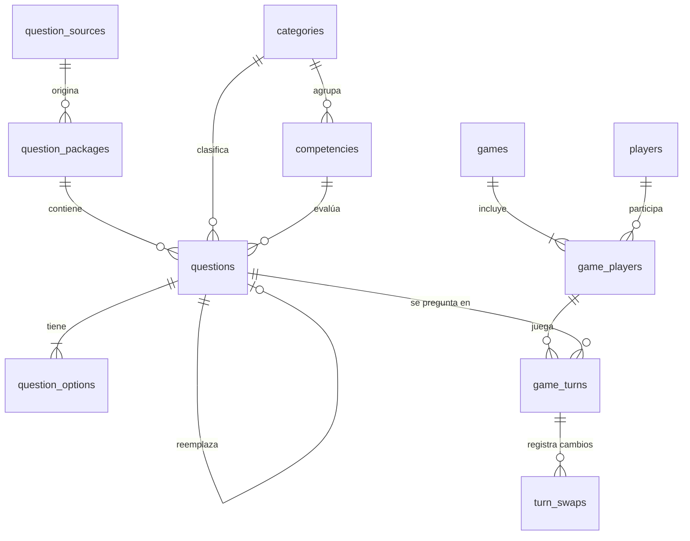

# SABERIA — Modelo de datos

> **Versión 1.** Diseño aprobado; **aún no hay migraciones ni código ORM** (paso 3 del plan).
> Motor: **MySQL 8.0.16 o superior**, InnoDB, `utf8mb4`. Acceso con SQLAlchemy 2, migraciones
> con Alembic y driver PyMySQL.
> Ver también: [architecture.md](architecture.md) · [question-package-format.md](question-package-format.md)

## 1. Convenciones

- Claves primarias `INT UNSIGNED AUTO_INCREMENT`; `BIGINT UNSIGNED` en `questions` y
  `game_turns`, las tablas que pueden crecer mucho.
- Estados y enumeraciones como `VARCHAR` con restricción `CHECK ... IN (...)`, **no** `ENUM` de
  MySQL (complica las migraciones y no es portable).
- Las restricciones `CHECK` solo se aplican desde MySQL 8.0.16; antes se ignoran en silencio. La
  aplicación comprueba la versión al arrancar y valida también en el motor.
- Fechas en UTC (`DATETIME`).
- No se guarda la fecha de nacimiento de los jugadores, solo su **franja de edad**.

## 2. Catálogos

**Franjas de edad** (`age_band`): `4-6`, `7-9`, `10-12`, `13-15`, `16-17`, `18+`.

| Franja | Años (mín–máx) |
|---|---|
| 4-6 | 4–6 |
| 7-9 | 7–9 |
| 10-12 | 10–12 |
| 13-15 | 13–15 |
| 16-17 | 16–17 |
| 18+ | 18–99 |

**Otros valores permitidos**

| Campo | Valores |
|---|---|
| `questions.qtype` | `single_choice` |
| `questions.origin` | `own`, `open_source`, `ai_assisted` |
| `questions.status` | `draft`, `validated`, `published`, `retired` |
| `games.mode` | `roulette`, `board` |
| `games.play_style` | `competitive`, `cooperative` |
| `games.status` | `in_progress`, `finished`, `abandoned` |
| `game_turns.outcome` | `correct`, `incorrect`, `skipped`, `timed_out` |
| `game_players.timer_seconds` | 10, 15, 20, 30, 45 |
| `questions.difficulty` | 1 a 5 (el MVP usa 1 a 3) |

## 3. Vista general



## 4. Contenido

### `question_sources`
| Columna | Tipo | Notas |
|---|---|---|
| id | INT UNSIGNED PK | |
| name | VARCHAR(120) | |
| license_code | VARCHAR(60) | Identificador SPDX cuando exista (`CC-BY-4.0`, `CC0-1.0`…) o `LicenseRef-SABERIA-Own` para contenido propio |
| license_url | VARCHAR(255) NULL | |
| attribution_text | VARCHAR(500) NULL | Texto de atribución exigido por la licencia |
| url | VARCHAR(255) NULL | |

### `question_packages`
| Columna | Tipo | Notas |
|---|---|---|
| id | INT UNSIGNED PK | |
| package_uid | CHAR(36) | UUID; **UNIQUE junto con `version`** |
| name | VARCHAR(120) | |
| version | VARCHAR(20) | |
| source_id | INT UNSIGNED FK → question_sources | |
| checksum_sha256 | CHAR(64) | Para importación idempotente |
| imported_at | DATETIME | |

### `categories`
`id`, `code` VARCHAR(40) **UNIQUE**, `name` VARCHAR(80), `sort_order` SMALLINT.

### `competencies`
`id`, `category_id` FK, `code` VARCHAR(60) **UNIQUE**, `name` VARCHAR(100), `description` VARCHAR(255) NULL.

### `questions`
| Columna | Tipo | Notas |
|---|---|---|
| id | BIGINT UNSIGNED PK | |
| package_id | INT UNSIGNED FK NOT NULL | Toda pregunta pertenece a un paquete |
| external_id | VARCHAR(64) | **UNIQUE junto con `package_id`** |
| replaces_question_id | BIGINT UNSIGNED FK NULL | Versión anterior que esta pregunta sustituye |
| language | VARCHAR(8) | `es` en el MVP |
| category_id / competency_id | INT UNSIGNED FK | |
| qtype | VARCHAR(16) | |
| prompt | VARCHAR(500) | |
| explanation | VARCHAR(1000) NULL | Obligatoria si `status = published` (validada al importar) |
| media_path | VARCHAR(255) NULL | Ruta relativa dentro de `assets/` |
| age_min / age_max | TINYINT UNSIGNED | Años; `CHECK age_min <= age_max` |
| difficulty | TINYINT UNSIGNED | `CHECK BETWEEN 1 AND 5` |
| origin / status | VARCHAR(16) | Ver catálogos |
| validated_by / validated_at | VARCHAR(80) / DATETIME NULL | |
| content_hash | CHAR(64) | SHA-256 del texto normalizado (detección de duplicados) |
| created_at / updated_at | DATETIME | |

**Restricción:** `origin = 'ai_assisted'` y `status = 'published'` exigen `validated_by` y
`validated_at`.

**Índices**
- `UNIQUE (package_id, external_id)`
- `(status, language, category_id, difficulty, age_min, age_max)` — selección de preguntas
- `(content_hash)`, `(competency_id)`

**Inmutabilidad:** una pregunta publicada no se edita. Para corregirla se crea una versión
nueva (`replaces_question_id`) y la anterior pasa a `retired`; así el historial de partidas no
cambia.

### `question_options`
`id`, `question_id` FK (ON DELETE CASCADE), `position` TINYINT, `text` VARCHAR(255),
`is_correct` BOOLEAN. **UNIQUE** (`question_id`, `position`).

Que exista **una y solo una** opción correcta, y entre 2 y 6 opciones, se valida en el
validador de paquetes y en el dominio, no en la base de datos.

## 5. Jugadores y partidas

### `players`
`id`, `display_name` VARCHAR(60), `age_band` (catálogo), `avatar_key` VARCHAR(40) NULL,
`created_at`, `archived_at` NULL.

### `games`
| Columna | Tipo | Notas |
|---|---|---|
| id | INT UNSIGNED PK | |
| mode | VARCHAR(16) | `roulette` en el MVP |
| play_style | VARCHAR(16) | `competitive` en el MVP |
| language | VARCHAR(8) | |
| rng_seed | BIGINT | Reproducibilidad (sorteos, selección de preguntas, pista) |
| config_json | JSON | `{rounds, hint_per_turn, swaps_per_turn}`. `hint_per_turn` ∈ {0, 1} (por defecto 0); `swaps_per_turn` ≤ 3 |
| status | VARCHAR(16) | |
| started_at / ended_at | DATETIME / NULL | |

### `game_players`
| Columna | Tipo | Notas |
|---|---|---|
| id | INT UNSIGNED PK | |
| game_id / player_id | FK | |
| seat | TINYINT | Orden de turno; `CHECK BETWEEN 1 AND 8` |
| age_band | VARCHAR(5) | Copia de la configuración usada en esa partida |
| difficulty | TINYINT | `CHECK BETWEEN 1 AND 5` (el MVP ofrece 1 a 3) |
| timer_seconds | TINYINT UNSIGNED | `CHECK IN (10,15,20,30,45)` |
| final_score | SMALLINT NULL | |

`UNIQUE (game_id, seat)`, `UNIQUE (game_id, player_id)`, índice `(player_id)`.

La edad y la dificultad se guardan **por jugador y por partida**: una familia mixta (un niño de
9 años con dos adultos) necesita configurarlas por separado.

### `game_turns`
| Columna | Tipo | Notas |
|---|---|---|
| id | BIGINT UNSIGNED PK | |
| game_id | FK | |
| game_player_id | FK | |
| turn_no | SMALLINT | `UNIQUE (game_id, turn_no)` |
| question_id | BIGINT UNSIGNED FK | Pregunta **final** del turno |
| selected_option_id | FK NULL | `NULL` si se omitió o venció el tiempo |
| outcome | VARCHAR(16) | Ver catálogos |
| points_awarded | TINYINT | `CHECK IN (0, 1)` |
| response_ms | INT UNSIGNED NULL | Desde que se muestra la pregunta |
| hint_used | BOOLEAN | |
| hint_removed_json | JSON NULL | Ids de las dos opciones eliminadas |
| asked_at | DATETIME | |
| context_json | JSON NULL | Segmento de la ruleta o casilla del tablero |

Índices: `(game_player_id, outcome)`, `(question_id)`.

### `turn_swaps`
`id`, `turn_id` FK, `seq` TINYINT (`CHECK BETWEEN 1 AND 3`), `replaced_question_id` FK,
`swapped_at`. **UNIQUE** (`turn_id`, `seq`).

Las preguntas descartadas por cambio quedan aquí; `game_turns.question_id` guarda solo la
última.

## 6. Consultas clave (esbozo)

**Perfil acumulado por competencia** (resultados educativos). La clasificación en sí
(≥ 5 respuestas evaluables, umbrales) se calcula en `analytics/`, no en SQL.

```sql
SELECT q.competency_id,
       SUM(t.outcome = 'correct') AS aciertos,
       COUNT(*)                   AS evaluables
FROM game_turns t
JOIN game_players gp ON gp.id = t.game_player_id
JOIN questions q     ON q.id = t.question_id
WHERE gp.player_id = :player_id
  AND t.outcome IN ('correct', 'incorrect')   -- omitidas y tiempos agotados no cuentan
  AND t.hint_used = 0                         -- respuestas con pista no cuentan
GROUP BY q.competency_id;
```

**Selección de candidatas** (edad = restricción dura; dificultad = blanda, con respaldo ±1/±2):

```sql
SELECT q.id
FROM questions q
WHERE q.status = 'published' AND q.language = :lang
  AND q.category_id = :category_id AND q.difficulty = :difficulty
  AND q.age_min <= :band_max AND q.age_max >= :band_min   -- solapamiento con la franja
  AND NOT EXISTS (SELECT 1 FROM game_turns t
                  WHERE t.game_id = :game_id AND t.question_id = q.id);
-- además se excluyen las descartadas en turn_swaps de la partida
-- el muestreo se hace sobre este subconjunto, nunca con ORDER BY RAND() sobre la tabla
```

## 7. Escala (más de 100.000 preguntas)

Preparado sin cargarlo ni desarrollarlo en el MVP:
- Claves `BIGINT` en `questions` y `game_turns`.
- Índice compuesto de selección y `content_hash` para detectar duplicados.
- Contadores de uso y preguntas vistas derivados de `game_turns`; no se crean tablas de caché
  hasta que se midan problemas reales.
- Los paquetes grandes se importan por lotes (ver
  [question-package-format.md](question-package-format.md)).

## 8. Fuera del MVP

`team_no` en `game_players` para el modo cooperativo (migración futura). El tablero se
describirá en un archivo JSON, no en tablas.
